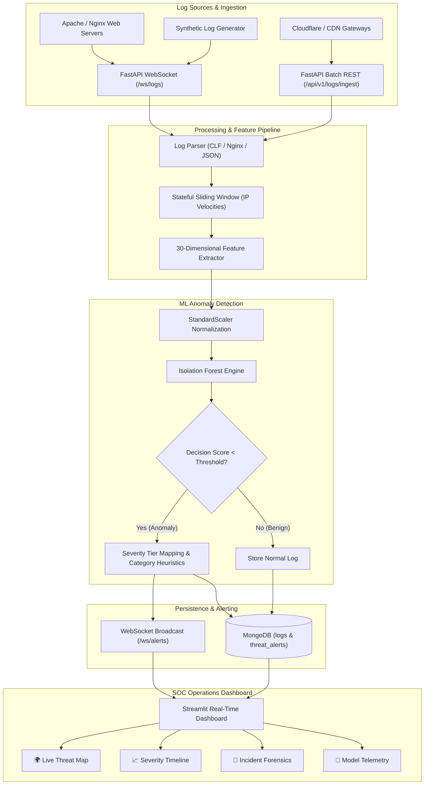

# 🛡️ SentinelAI: Real-Time Threat Detection & Log Analytics Platform

[](https://opensource.org/licenses/MIT)
[](https://python.org)
[](https://fastapi.tiangolo.com)
[](https://streamlit.io)
[](https://scikit-learn.org)
[](https://mongodb.com)
[](https://docker.com)

> **SentinelAI** is an enterprise-grade SIEM and Machine Learning telemetry pipeline designed to ingest high-velocity HTTP server logs in real time, extract a 30-dimensional behavioral and syntactic feature space, evaluate traffic anomalies with an **Isolation Forest** model, and push instant threat intelligence to an interactive Security Operations Center (SOC) dashboard.

---

## 📌 Table of Contents

- [Key Features](#-key-features)
- [Architecture](#-architecture)
- [Tech Stack](#-tech-stack)
- [Machine Learning Engine & 30-Feature Vector](#-machine-learning-engine--30-feature-vector)
- [Quick Start](#-quick-start)
  - [Prerequisites](#prerequisites)
  - [Docker Compose (Recommended)](#docker-compose-recommended)
  - [Manual Local Setup](#manual-local-setup)
- [API Reference](#-api-reference)
- [WebSockets Streaming](#-websockets-streaming)
- [Synthetic Traffic Generation & Training](#-synthetic-traffic-generation--training)
- [Dashboard Preview & UI Capabilities](#-dashboard-preview--ui-capabilities)
- [Configuration & Environment Variables](#-configuration--environment-variables)
- [Author & License](#-author--license)

---

## 🚀 Key Features

- **⚡ Real-Time Ingestion**: Bi-directional WebSockets (`/ws/logs`, `/ws/alerts`) and REST batch ingestion supporting Apache CLF, Nginx, and JSON log streams.
- **🧠 30-Dimensional Feature Extraction**: Sub-millisecond calculation of Shannon entropy, rolling IP velocities (1m and 5m windows), error ratios, special character distributions, and signature heuristics (SQLi, XSS, Path Traversal, Command Injection).
- **🌲 Isolation Forest Anomaly Detection**: Unsupervised multivariate outlier detection scoring request vectors without reliance on static IP blacklists.
- **🌍 Live Threat Map**: Interactive Plotly scatter-geo visualization displaying global attack origin coordinates, threat severity, and geographic clustering.
- **🚨 SOC Incident Action Center**: Drill-down forensic analyzer highlighting the exact anomalous features causing high Z-score deviations with one-click analyst acknowledgment.
- **📊 Real-Time Analytics**: Live timeline buckets, severity breakdown (Critical, High, Medium, Low), attack vector classification donut charts, and throughput metrics.
- **🐳 Turnkey Containerization**: Complete multi-container deployment ready with Docker Compose for MongoDB, FastAPI backend, and Streamlit dashboard.

---

## 🏛️ Architecture



---

## 💻 Tech Stack

| Component | Technology | Description |
|---|---|---|
| **API & Ingestion Gateway** | FastAPI, Uvicorn | Async ASGI server handling REST and WebSocket streaming |
| **Machine Learning** | Scikit-Learn, NumPy, Joblib | Isolation Forest, StandardScaler, Feature Engineering |
| **Data Processing** | Pandas | Tabular log transformations and metric aggregations |
| **Visualization & UI** | Streamlit, Plotly | SOC dark-themed dashboard, 3D scatter geo maps, timelines |
| **Database** | MongoDB 7.0, Motor | High-throughput asynchronous document store |
| **Deployment** | Docker, Docker Compose | Multi-container orchestrated microservices |
| **Language** | Python 3.11+ | Fully typed, modular codebase |

---

## 🔬 Machine Learning Engine & 30-Feature Vector

SentinelAI inspects every incoming HTTP request through an enriched 30-dimensional feature space:

| # | Feature Name | Category | Description |
|---|---|---|---|
| 1 | `req_length` | Structural | Total character length of URI path |
| 2 | `query_param_count` | Structural | Total number of query parameters |
| 3 | `query_length` | Structural | Length of URL query string |
| 4 | `payload_entropy` | Information Theory | Shannon entropy of URI + request payload |
| 5 | `special_char_count` | Structural | Count of symbols (`<`, `>`, `'`, `"`, `;`, `--`, `/*`, `$`, `\`, `|`) |
| 6 | `special_char_ratio` | Structural | Ratio of special characters to request length |
| 7 | `digit_count` | Structural | Number of numerical digits in URI |
| 8 | `digit_ratio` | Structural | Ratio of numerical digits to request length |
| 9 | `uppercase_ratio` | Structural | Ratio of uppercase characters to alpha characters |
| 10 | `status_code` | Response | Numeric HTTP status code |
| 11 | `is_error_status` | Response | Flag for status code >= 400 |
| 12 | `is_server_error` | Response | Flag for status code >= 500 (unhandled crash / exploit) |
| 13 | `response_bytes` | Response | Size of response payload |
| 14 | `hour_of_day` | Temporal | Hour (0–23) of request timestamp |
| 15 | `is_weekend` | Temporal | Binary indicator for Saturday/Sunday |
| 16 | `is_off_hours` | Temporal | Binary flag for traffic outside 08:00–18:00 |
| 17 | `ip_req_freq_1m` | Velocity | Rolling request count from IP within last 60 seconds |
| 18 | `ip_req_freq_5m` | Velocity | Rolling request count from IP within last 300 seconds |
| 19 | `ip_error_freq_5m` | Velocity | Rolling count of 4xx/5xx errors from IP |
| 20 | `unique_endpoints_count` | Velocity | Unique endpoints probed by IP within window |
| 21 | `user_agent_length` | Client Identity | Character length of User-Agent header |
| 22 | `user_agent_entropy` | Client Identity | Shannon entropy of User-Agent string |
| 23 | `is_known_scanner_ua` | Client Identity | Regex flag for tools (sqlmap, nikto, nmap, gobuster) |
| 24 | `is_empty_user_agent` | Client Identity | Missing or blank User-Agent header |
| 25 | `method_encoded` | Protocol | Categorical numeric mapping of HTTP method |
| 26 | `is_post_or_put` | Protocol | Flag for payload-bearing methods |
| 27 | `sqli_signature_match` | Signatures | Heuristic regex match count for SQL injection syntax |
| 28 | `xss_signature_match` | Signatures | Heuristic regex match count for XSS tags & event handlers |
| 29 | `traversal_signature_match` | Signatures | Regex match count for directory traversal (`../`, `%2e%2e`) |
| 30 | `cmd_signature_match` | Signatures | Regex match count for shell command injection (`cat`, `wget`, pipe) |

### Isolation Forest Decision Thresholds

The Isolation Forest algorithm isolates anomalies by randomly partitioning feature values. Points requiring few partitions yield low negative decision scores:

- **CRITICAL** (`score <= -0.35` or Active Exploitation): Instant IP block recommendation.
- **HIGH** (`-0.35 < score <= -0.25`): High-priority incident alert with rate limiting.
- **MEDIUM** (`-0.25 < score <= -0.15`): Behavioral anomaly; trigger challenge verification.
- **LOW** (`-0.15 < score <= -0.05`): Mild deviation; logged for behavioral profiling.
- **NORMAL** (`score > -0.05`): Standard traffic.

---

## ⚡ Quick Start

### Prerequisites

- **Docker & Docker Compose** (preferred) OR **Python 3.11+** & **MongoDB 7.0**

---

### Docker Compose (Recommended)

1. Clone the repository:
   ```bash
   git clone https://github.com/praveen0515/SentinelAI.git
   cd SentinelAI
   ```

2. Copy the environment configuration:
   ```bash
   cp .env.example .env
   ```

3. Build and launch all containers:
   ```bash
   docker-compose up --build -d
   ```

4. Verify services:
   - **FastAPI API & Docs**: [http://localhost:8000/docs](http://localhost:8000/docs)
   - **Streamlit SOC Dashboard**: [http://localhost:8501](http://localhost:8501)
   - **MongoDB**: `localhost:27017`

5. Inject simulated traffic to see live alerts:
   ```bash
   docker exec -it sentinel-backend python scripts/generate_sample_logs.py --count 1000 --stream-url http://localhost:8000/api/v1/logs/ingest
   ```

---

### Manual Local Setup

1. Create and activate a virtual environment:
   ```bash
   python3 -m venv venv
   source venv/bin/activate
   ```

2. Install backend and dashboard dependencies:
   ```bash
   pip install -r backend/requirements.txt
   pip install -r dashboard/requirements.txt
   ```

3. Train the baseline Isolation Forest model:
   ```bash
   python scripts/train_model.py --count 3000 --contamination 0.08
   ```

4. Run the FastAPI backend:
   ```bash
   uvicorn backend.main:app --host 0.0.0.0 --port 8000 --reload
   ```

5. In a separate terminal, launch the Streamlit dashboard:
   ```bash
   streamlit run dashboard/app.py --server.port 8501
   ```

---

## 📡 API Reference

### Health & Diagnostics
- `GET /health`: Component health status (API, MongoDB status, model load status).
- `GET /api/v1/model/status`: Active feature set, thresholds, and inference latency statistics.

### Ingestion Endpoints
- `POST /api/v1/logs/ingest`: Ingest a single log (raw string or JSON).
- `POST /api/v1/logs/ingest/batch`: High-throughput batch ingestion endpoint.

### Query & Alert Endpoints
- `GET /api/v1/logs`: Historical log query with filtering (`limit`, `threat_only`, `min_severity`, `ip`).
- `GET /api/v1/alerts`: Query detected threat alerts with status filtering.
- `POST /api/v1/alerts/{alert_id}/acknowledge`: Mark an alert as reviewed by SOC analyst.

### Analytics & Aggregations
- `GET /api/v1/analytics/stats`: Top-level SIEM metrics (total logs, anomaly rate, active threats).
- `GET /api/v1/analytics/top-ips`: Top attacking IP addresses and geo details.
- `GET /api/v1/analytics/timeline`: Hourly bucket aggregations for threat velocity.
- `GET /api/v1/analytics/geo`: Aggregated geographic coordinates for live map visualization.
- `GET /api/v1/analytics/categories`: Categorical distribution of attack vectors.

---

## 🌐 WebSockets Streaming

SentinelAI provides two high-performance WebSocket channels:

1. **Log Ingestion Stream**: `ws://localhost:8000/ws/logs`
   - Clients stream log messages in real time. The server parses, runs inference, and responds with immediate classification.
2. **SOC Alert Push Stream**: `ws://localhost:8000/ws/alerts`
   - Dashboards subscribe to this feed to receive sub-second alerts whenever an anomaly is flagged.

---

## 🛠️ Synthetic Traffic Generation & Training

Generate realistic attack vectors and normal traffic using the included utility:

```bash
# Generate 2,000 logs in JSON format
python scripts/generate_sample_logs.py --count 2000 --output data/sample_logs.json

# Generate Apache Combined Log Format file
python scripts/generate_sample_logs.py --count 1500 --format apache --output data/access.log

# Stream 500 logs directly to the live backend with a 50ms delay
python scripts/generate_sample_logs.py --count 500 --stream-url http://localhost:8000/api/v1/logs/ingest --delay 0.05
```

Train or recalibrate the Isolation Forest model:
```bash
python scripts/train_model.py --count 4000 --contamination 0.05 --output data/isolation_forest.joblib
```

---

## 🖼️ Dashboard Preview & UI Capabilities

The Streamlit dashboard offers:
1. **Executive KPI Cards**: Real-time log count, anomaly rate, model F1-score, and average inference latency.
2. **Global Threat Origin Map**: Interactive Plotly projection mapping attack source clusters color-coded by severity.
3. **Temporal Dynamics**: Stacked hourly bar charts monitoring threat volume spikes.
4. **Incident Deep Dive**: Inspector allowing analysts to view raw URIs, payload entropy, and exact feature Z-score deviations.
5. **Interactive Attack Injection**: Live button to inject sample attack batches directly for testing.

---

## ⚙️ Configuration & Environment Variables

| Variable | Default | Description |
|---|---|---|
| `APP_NAME` | `SentinelAI` | Application title |
| `ENVIRONMENT` | `development` | Deployment environment (`development` / `production`) |
| `HOST` | `0.0.0.0` | Server host binding |
| `PORT` | `8000` | Server port binding |
| `MONGODB_URI` | `mongodb://localhost:27017` | MongoDB connection URI |
| `MONGODB_DB_NAME` | `sentinel_ai` | MongoDB database name |
| `CONTAMINATION_RATE` | `0.05` | Expected anomaly ratio for Isolation Forest |
| `N_ESTIMATORS` | `150` | Number of trees in Isolation Forest ensemble |
| `BACKEND_URL` | `http://localhost:8000` | Backend API URL used by the Streamlit dashboard |

---

## 👤 Author & License

- **Author**: Praveen Patil
- **GitHub**: [@praveen0515](https://github.com/praveen0515)
- **LinkedIn**: [Praveen Patil](https://linkedin.com/in/praveen0515)
- **License**: Released under the [MIT License](LICENSE). Copyright © 2026 Praveen Patil.
